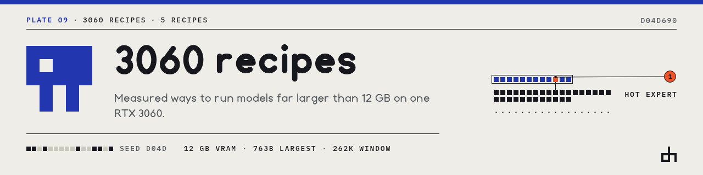

<picture>
  <source media="(prefers-color-scheme: dark)" srcset="site/assets/readme-dark.png">
  
</picture>

# 3060-recipes

How to run models that don't fit in VRAM on a single RTX 3060 12 GB (with 62 GB RAM and NVMe), with measured tokens/s.

**Site:** [davidghatley.github.io/3060-recipes](https://davidghatley.github.io/3060-recipes/) · for agents: [`llms.txt`](https://davidghatley.github.io/3060-recipes/llms.txt), [`recipes.json`](https://davidghatley.github.io/3060-recipes/recipes.json), [`AGENTS.md`](https://davidghatley.github.io/3060-recipes/AGENTS.md)

Own a 3060? [Report your numbers for a recipe or submit your own](CONTRIBUTING.md). The [`skills/`](skills/) folder has agent skills for finding, running and submitting recipes.

| Recipe | Model | Engine | Decode | Prefill |
|---|---|---|---|---|
| [deepseek-v41-strata](deepseek-v41-strata/) | DeepSeek-V4.1-Flash 763B, IQ2_XXS 2.00 bpw | Strata | 4.6–5.0 tok/s from NVMe (0.46 from a hard disk) | 90–125 tok/s |
| [flint](flint/) | Flint 40B-A2.5B MoE, Q4_K_M, 128k ctx | llama.cpp b12242 (experts in RAM + MoE cache) | 58.8 tok/s (stock 48.2); 47 @ 32k | 1,708 tok/s (stock 329) |
| [qwen35-3d-coder](qwen35-3d-coder/) | Qwen3.5-4B-3D-Coder, Q5_K_M | llama.cpp | 77.5 tok/s task-weighted (81 reasoning, 74 code); Q8_0 baseline 61. Restored MTP head gives 102 (opt-in: same page pass rate and tokens plain decoding would also pick, but more syntax-error pages, cause unknown) | 2,480 tok/s (32k prompt) |
| [inkling-2-mini](inkling-2-mini/) | Inkling-2-Mini 26.4B MoE (looped core ×3), IQ4_NL, 64k ctx | llama.cpp master + 2 patches (loop-core experts on GPU, rest in RAM) | 29.0 tok/s (stock 17.5); 23.7 @ 32k | 145 tok/s at 8k (stock 39) |
| [kintsugi-27b](kintsugi-27b/) | Kintsugi-27B (Qwen3.8-27B dense), EXL3 trellis 2.47 bpw, 262k ctx | author's llama.cpp fork bundle v1.1.1 (tiered K/V cache, DFlash2 drafter) | 39.4 tok/s chat, 60.2 code with the drafter (16.2 / 16.1 without) | 600–660 tok/s |

## Shared tooling, and where it is duplicated

- `scripts/bench.py`: streaming prefill/decode client plus a 1 s sampler (VRAM, RAM, page cache, CPU busy, reads on the disk that holds the model). Used by deepseek-v41-strata.
- `scripts/codeeval.py`: 8 Python tasks checked against asserts at temperature 0. It is a copy of `inkling-2-mini/tools/codeeval.py` with `--url` and `--out` required, so it can be pointed at any server. The two copies should become one.
- "Start a server through `gpu_run`, wait until it is healthy, run tests, stop it" exists four times: `flint/experiments/tools/srv.sh`, `qwen35-3d-coder/tools/with_server.sh` (and `qualify.sh`, `evalrun.sh`), `deepseek-v41-strata/run_variant.sh`, `inkling-2-mini/tools/serverrun.sh`. On 2026-11-22 the flint and qwen copies had the same bug. While queued for the GPU lock they trusted whatever answered on their port, and gave up without ending the queued launcher, which later started a server with no owner. It was fixed in both by finding the server as the script's own child and ending the launcher tree on exit. `qualify.sh` still finds its server by port, so use it only when the lock is free. `evalrun.sh` takes the lock before it starts its server, so it is not exposed. `inkling-2-mini/tools/serverrun.sh` has the same structure as the old flint copy and should get the same check. A shared helper would stop the next bug being fixed in only one place.

## Site

`site/build.py` turns each recipe's `recipe.json`, README and RESULTS, the `findings/` notes and `site/data/` into the static site in `_site/` (HTML plus a Markdown twin of every page, JSON indexes, `llms.txt`). GitHub Actions builds and deploys it on every push to `main`.

```sh
python3 -m venv .venv && .venv/bin/pip install -r site/requirements.txt
.venv/bin/python scripts/validate_recipe.py --findings   # every recipe.json and finding
.venv/bin/python site/build.py --check                  # builds _site/, fails on broken links or private paths
```

## License

Scripts, patches, tools and skills: MIT ([LICENSE](LICENSE)). Recipe text, results and findings: CC BY 4.0 ([LICENSE-CONTENT](LICENSE-CONTENT)). Models and engines keep their own licenses.
